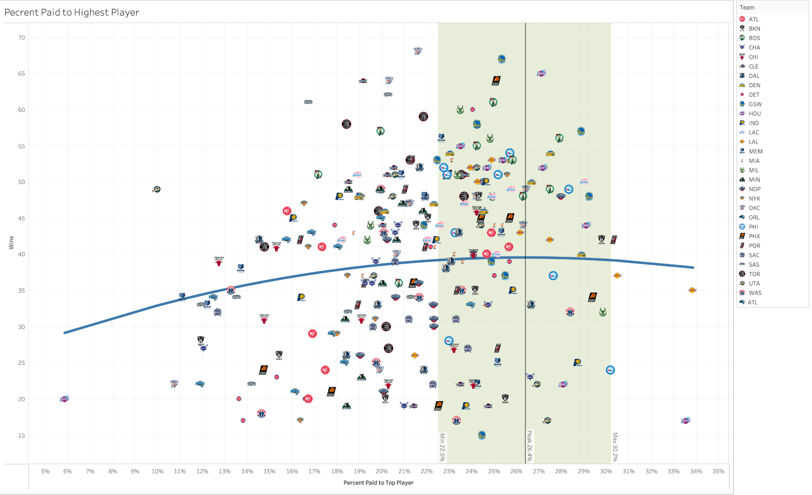
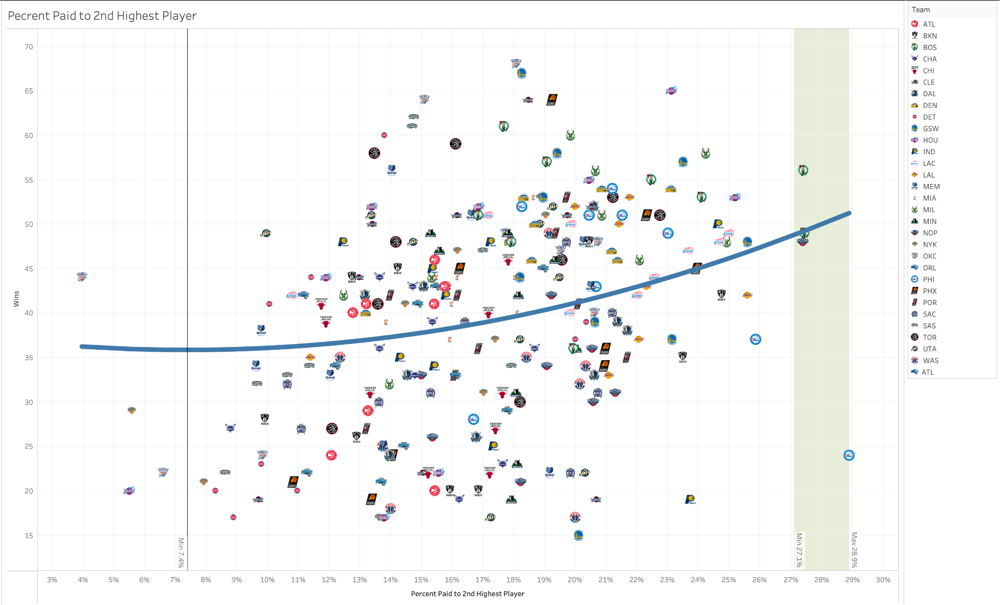
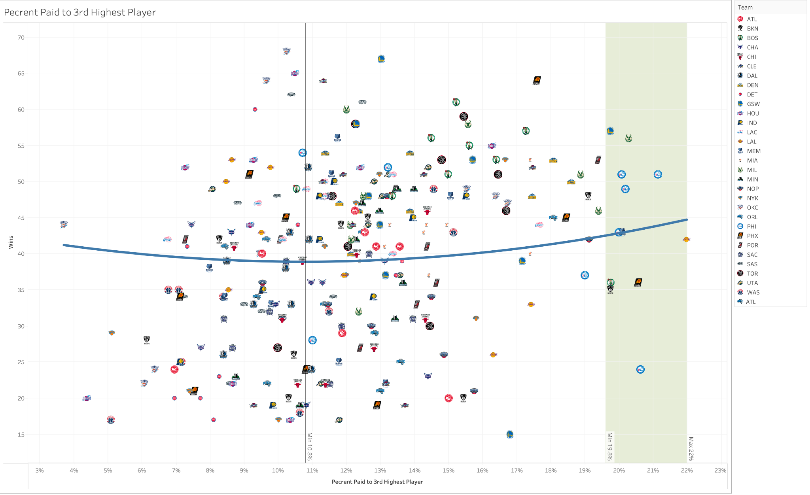
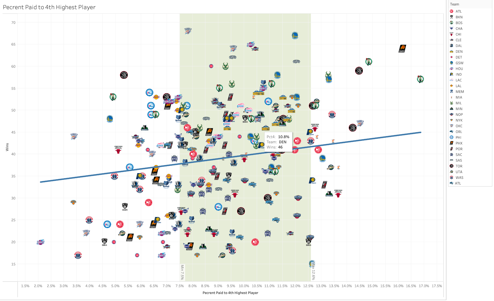
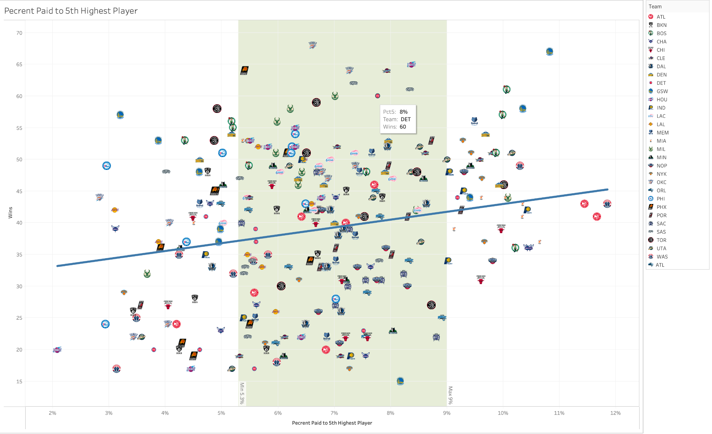

# The Supermax Trap: NBA Roster Construction & Winning Efficiency

**Econometric research · Python & Jupyter · MySQL · Tableau**  
**Grantham Phillips | NC State University**

> **Research question:** How does the distribution of player salaries—and the tradeoff between star contracts and roster depth—relate to NBA regular-season wins?

This project examines NBA roster construction as a resource-allocation problem under salary-cap constraints. It combines a **270 team-season analytical dataset**, an **original three-table relational MySQL database (7,790 records)**, **two OLS regression specifications**, five original Tableau charts, and a full economics research paper. The data span **2017–18 through 2025–26**.

## At a glance

| Component | What's included |
| --- | --- |
| **Python analysis** | Clean, fully executable Jupyter notebook reproducing the two primary regressions and paper figures |
| **Data** | Original 38-column team-season CSV (270 populated observations), plus a verified modeling extract |
| **SQL database** | Original MySQL `Teams` (270), `Player` (3,760), and `Contracts` (3,760) tables, including keys and records |
| **Tableau** | Five custom NBA-team scatterplots showing salary allocation against season wins, with fitted trends and highlighted exploratory ranges |
| **Research paper** | Full 24-page study, including theoretical context, data definitions, methods, findings, and limitations |

## Research design

The study estimates two complementary ordinary least squares (OLS) models:

1. **Contract / organizational model:** Wins versus prior-season wins, All-Star count, maximum/supermaximum contract categories, injury-related salary loss, analytics staffing, and the combined spending share for the fourth and fifth highest-paid players.
2. **Salary-allocation model:** Wins versus the top five earners' salary shares. The top three enter linearly and quadratically; fourth and fifth shares enter linearly.

The cleaned notebook executes in order from the supplied base CSV and reproduces the paper's original estimates. The original design and findings are preserved rather than retroactively replaced.

## Selected findings

| Result | Estimate |
| --- | ---: |
| Linear model adjusted R² | **0.454** |
| Quadratic model adjusted R² | **0.207** |
| Linear: additional All-Star, conditional association | **+4.408 wins** |
| Linear: `pct45` coefficient | **+47.821 per full-unit salary share** (≈ +0.478 wins per percentage point) |
| Quadratic: `pct5` coefficient | **+123.649 per full-unit salary share** (≈ +1.236 wins per percentage point) |

The paper emphasizes the apparent importance of roster depth and notes that supermax indicators were not statistically significant in the linear model.

**Statistical caution:** These are **observational, in-sample associations**, not estimates of what would happen if a team changed spending. The quadratic terms for the top three earners were individually not statistically significant, and the green bands in the Tableau charts are the author's **exploratory ranges**, not validated optimal salary shares or confidence intervals.

## Tableau visualizations

Five original Tableau plots show team-season wins (vertical axis) against the salary share of each of the five highest-paid roster spots. Each NBA logo marks a team-season; the blue line is the fitted quadratic or linear spending relationship, and the shaded green bands are **paper-reported exploratory ranges**. Click any visualization to view it at full resolution.

<table>
<tr>
<td width="50%" align="center">
<b>1. Highest-paid player</b><br>
<a href="tableau/01-highest-paid-player.png"></a>
</td>
<td width="50%" align="center">
<b>2. Second highest-paid player</b><br>
<a href="tableau/02-second-highest-paid-player.png"></a>
</td>
</tr>
<tr>
<td align="center">
<b>3. Third highest-paid player</b><br>
<a href="tableau/03-third-highest-paid-player.png"></a>
</td>
<td align="center">
<b>4. Fourth highest-paid player</b><br>
<a href="tableau/04-fourth-highest-paid-player.png"></a>
</td>
</tr>
<tr><td colspan="2" align="center">
<b>5. Fifth highest-paid player</b><br>
<a href="tableau/05-fifth-highest-paid-player.png"></a>
</td></tr>
</table>

These charts are **descriptive, bivariate visualizations**; their trend lines are not the controlled, multivariable effects estimated in the Python models. The plots are **static images exported from Tableau**. The original interactive Tableau workbooks are not part of this repository.

## Relational database design

The project also includes the author's **original MySQL database dump**, which retains the three related tables and their data. This is not a reconstructed database.

```text
Teams (270 team-season records)
  PK: Year + Team
  ├── Player (3,760 player-season records)
  │     PK: Player + Year
  │     FK: Year + Team → Teams
  └── Contracts (3,760 player-season salary records)
        PK: Player + Year
        FK: Player + Year → Player
        FK: Year + Team → Teams
```

See [`sql/README.md`](sql/README.md) for schema details and optional MySQL import instructions. The SQL is included to demonstrate relational data work; **running the notebook does not require installing MySQL**.

## Repository contents

```text
NBA-Salary-Analysis-The-Supermax-Trap/
├── README.md
├── nba_supermax_analysis.ipynb     # Clean, executed Jupyter notebook
├── requirements.txt
├── .gitignore
├── data/
│   ├── NBASupermaxTrap.csv        # Original full 38-column team-season dataset
│   ├── nba_modeling_data.csv      # Matching 19-variable analysis snapshot
│   └── README.md
├── sql/
│   ├── NBASalary.sql             # Original MySQL database dump with data and schema
│   └── README.md
├── tableau/
│   ├── 01-highest-paid-player.png
│   ├── 02-second-highest-paid-player.png
│   ├── 03-third-highest-paid-player.png
│   ├── 04-fourth-highest-paid-player.png
│   └── 05-fifth-highest-paid-player.png
└── paper/
    └── The_Supermax_Trap_Research_Paper.pdf
```

## Reproduce the analysis

```bash
# Clone after the repository is published under this name
git clone https://github.com/granthamphillips/NBA-Salary-Analysis-The-Supermax-Trap.git
cd NBA-Salary-Analysis-The-Supermax-Trap
python -m pip install -r requirements.txt
jupyter notebook nba_supermax_analysis.ipynb
```

Use **Run → Run All Cells**. The notebook loads the author-supplied CSV, excludes its trailing blank row, checks against the original modeling extract, estimates both models, and produces the paper's central statistical charts. Saved notebook outputs are included for GitHub viewers who don't run Python.

The original [research paper](paper/The_Supermax_Trap_Research_Paper.pdf) provides the economic framing, variable definitions, literature review, and deeper discussion.

## Data sources and limitations

The original research paper cites **Spotrac** for contracts, salaries, and team records; **RealGM** for All-Star rosters; and **NBAstuffer** plus the **Wayback Machine** for historical analytics staffing. It states that missing 2018–19 analytics staff data were interpolated from neighboring seasons.

- The repository includes **compiled author-provided data**, not scripts to independently scrape or rebuild all sources.
- Model fit statistics are **in-sample**; they are not measures of out-of-sample predictive performance.
- Salary is an imperfect proxy for player quality, and salary shares are jointly constrained, so independently varying one component is not necessarily roster-feasible.
- Regressions omit some team-specific factors (e.g., coaching or player development) and do not identify causal effects.
- The paper's proposed spending bands are exploratory, especially given the imprecision of the top-three quadratic effects. They should not be understood as confidence intervals or statistically proven optima.

## Technical stack

**Python** · pandas · NumPy · statsmodels · Matplotlib · seaborn · Jupyter · **MySQL / SQL** · **Tableau**
